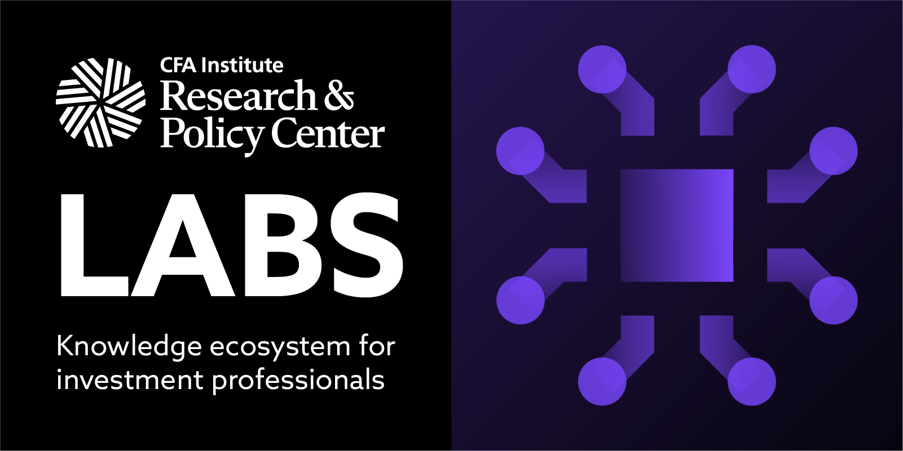

# Welcome to RPC Labs

**RPC Labs** is where finance meets technology. Powered by [CFA Institute Research & Policy Center (RPC)](https://rpc.cfainstitute.org/themes/technology/rpclabs), it’s a collaborative community for finance professionals, data scientists, and developers to create open-source tools, share knowledge, and drive innovation at the intersection of finance, data science, and AI/ML.

Our mission is fostering open collaboration among CFA Institute  members, candidates, and tech enthusiasts. With tools and projects tailored to the financial industry, RPC Labs is building an inclusive space for contribution, learning, and growth.

---

## 🌟 Why Join RPC Labs?
- **Learn and explore**: Access curated resources and tools designed for investment professionals and tech enthusiasts.
- **Collaborate and build**: Join a global community shaping the future of financial data science through open-source innovation.
- **Contribute and engage**: Share your expertise, provide feedback, and help refine projects that impact the investment industry.

## 🚀 How to Get Involved

### 1. Explore Existing Repositories
- Browse our [GitHub repositories](https://github.com/CFA-Institute-RPC) for open-source tools related to financial modeling, AI applications, and risk analysis.
- Star and follow your favorite repositories to stay updated.

### ⭐ Show Your Support
- Help us grow the community by starring our repositories! Click the ⭐ button on GitHub to show your support and stay notified about updates.

### 2. Join Our Community
- **Discord**: Connect with like-minded professionals and discuss ideas. [Join here](https://discord.com/invite/prJ3xFWqMW).
- **GitHub Discussions**: Engage in discussions, provide feedback, and suggest improvements.

### 3. Contribute to the Project
- Read the [Contribution Guidelines](https://github.com/CFA-Institute-RPC/.github/blob/main/CONTRIBUTING.md) to learn how to make meaningful contributions.
- Submit pull requests, suggest new features, or improve documentation.

## 📂 Featured Repositories

- **[Network Climate Transition Risk Tool](https://github.com/CFA-Institute-RPC/cgfi-finshock)**  
  This repository contains the code for analyzing systemic climate transition risks in interconnected financial systems. It supports scenario-based analysis to help policymakers and financial professionals assess risk propagation.

- **[AI and Big Data Technology Usage Heatmap](https://github.com/CFA-Institute-RPC/AI-finance-workflow-heatmap)**  
  Explore how investment professionals are adopting AI and big data technologies in workflows like risk oversight and advisory. This repository includes code and resources to create an interactive heatmap visualization.

- **[The Automation Ahead](https://github.com/CFA-Institute-RPC/The-Automation-Ahead)**  
  Hands-on GenAI applications for investment workflows, featuring Python scripts from our research series.

Explore all repositories in [our GitHub organization](https://github.com/CFA-Institute-RPC).

## 🛠️ Contribution Guidelines
Your contributions make a difference. Whether coding, sharing insights, or improving documentation, your expertise is valuable.

### How to Contribute:
1. **Read the guidelines**: Start with our [CONTRIBUTING.md](https://github.com/CFA-Institute-RPC/.github/blob/main/CONTRIBUTING.md).
2. **Fork and Star**: Fork a repository, make your changes, and submit a pull request.
3. **Engage**: React, comment, or start a discussion in our repositories.

## 📜 Legal Notices
- **License**: All projects in RPC Labs are licensed under the [MIT License](https://github.com/CFA-Institute-RPC/.github/blob/main/LICENSE) unless stated otherwise.
- **Disclaimer**: All code is provided **"as-is"** without warranties. Users are responsible for security risks and compliance with applicable laws. See [Disclaimer.md](https://github.com/CFA-Institute-RPC/.github/blob/main/Disclaimer.md) for full details.

## 💬 Join the Conversation
- **Discord**: [Join discussions](https://discord.com/invite/prJ3xFWqMW) and collaborate with peers.
- **GitHub Discussions**: Share ideas and ask questions.
- **Engage**: Star repositories, open issues, and contribute pull requests.

---
We look forward to building the future of financial data science with you!

